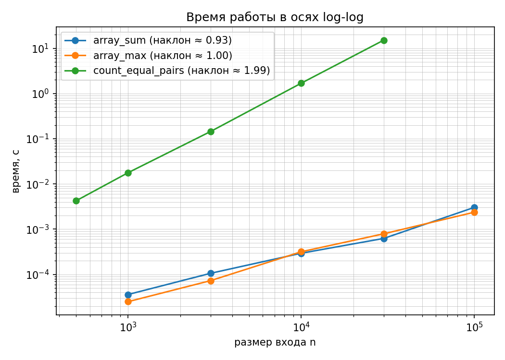
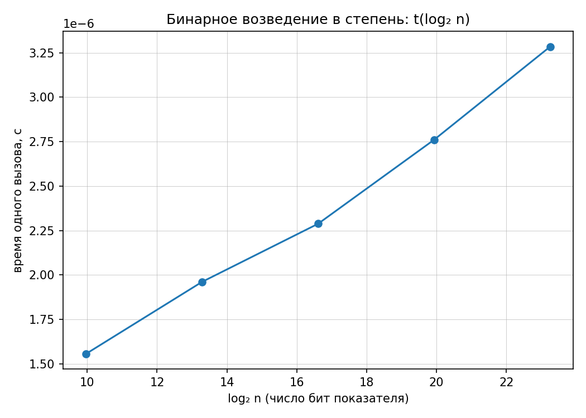

# Лабораторная работа 1

Вариант 6

Тема: анализ временной сложности элементарных алгоритмов.

## Что сделал

Исправил код в файле `lab01-complexity-starter.py`.

Реализовал:
- `array_sum`
- `array_max`
- `count_equal_pairs`
- `binary_pow`

После этого запустил программу и проверил все функции.

Проверка закончилась:

`self_check: OK`

## Сложность

`array_sum` — O(n)

`array_max` — O(n)

`count_equal_pairs` — O(n²)

`binary_pow` — O(log n)

## Результаты

Для `array_sum` получился наклон 0.927.

Для `array_max` получился наклон 0.998.

Для `count_equal_pairs` получился наклон 1.993.

Полученные значения близки к теоретическим 1, 1 и 2.

Для `binary_pow` использовал график зависимости времени от `log2(n)`, потому что алгоритм имеет логарифмическую сложность.

## Графики

## Вывод

Код работает, проверки прошли. Результаты эксперимента в целом совпали с теоретической сложностью алгоритмов.
