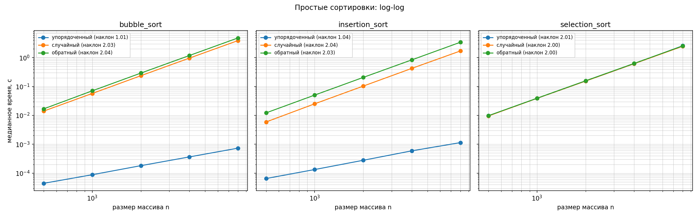
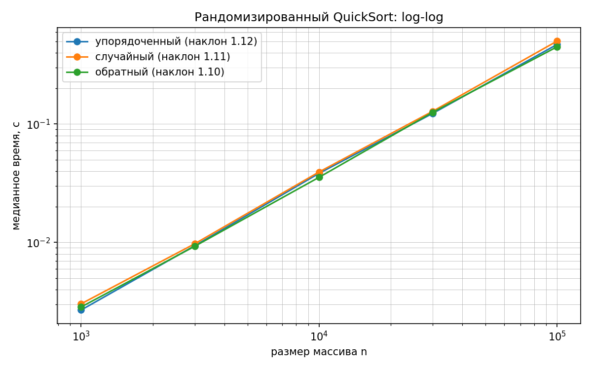

# Лабораторная работа 3. Простые сортировки и QuickSort

**Вариант:** 6  
**Seed:** `30 + 6 = 36`  
**Среда замера:** Windows 11, Python 3.13.12; таймер `time.perf_counter()`.  
**Методика:** отдельный прогрев, затем 5 повторов для каждой точки; в таблицу берётся медиана. Время самой сортировки включает создание её внутренней копии входа, но не включает подготовку исходного массива.

## Что реализовано

Код находится в [`lab03-simple-sorts-quicksort.py`](lab03-simple-sorts-quicksort.py). Отдельная копия для загрузки и объяснения — [`lab03-full-code.py`](lab03-full-code.py).

- **Bubble sort:** сравнивает соседние элементы, считает сравнения и обмены. Если проход не сделал обменов, сортировка завершается. Лучший случай `O(n)`, средний и худший `O(n²)`. Устойчива, так как равные элементы не меняются местами.
- **Insertion sort:** вставляет очередной элемент в отсортированный префикс. Считает сравнения, сдвиги и запись вставляемого элемента. Лучший случай `O(n)`, средний и худший `O(n²)`. Устойчива благодаря строгой проверке `>`.
- **Selection sort:** выбирает минимум оставшейся части. Считает сравнения и фактические обмены. Всегда выполняет `n(n−1)/2` сравнений, то есть `Θ(n²)`, и не более `n−1` обменов. Нестабильна.
- **QuickSort:** выбирает pivot через `rng.randrange(lo, hi)`, разбивает массив на элементы меньше, равные и больше pivot и рекурсивно обрабатывает меньшую часть. Среднее время `O(n log n)`, худшее `O(n²)`; глубина рекурсии остаётся `O(log n)` за счёт обработки меньшей части рекурсивно. Считает сравнения и обмены. Нестабилен.

Счётчик «обмены» означает одну фактическую перестановку двух элементов. У вставок «перемещения» — каждый сдвиг элемента и каждая запись вставляемого элемента. В счётчике QuickSort «перемещения» означают обмены. Все сортировки возвращают новый список и оставляют исходный без изменений.

## Проверки

`self_check` проверяет:

1. Пустой список, один элемент, равные элементы, отсортированный и обратный порядок.
2. Два инварианта результата: элементы идут по неубыванию, результат является перестановкой исходного списка.
3. Сверку с `sorted()` на 300 случайных массивах для каждого алгоритма.
4. Что исходный список не изменился.
5. Точные контрольные счётчики: bubble sort на упорядоченных и обратных пяти элементах, insertion sort на тех же входах, а также `n(n−1)/2` сравнений selection sort.
6. Стабильность на парах `(ключ, метка)`, когда сортировка сравнивает только ключ.

Результат запуска: все проверки завершились `OK`. В демонстрации на `[(2, 'a'), (2, 'b'), (1, 'c')]` Bubble sort и Insertion sort сохраняют метки равных ключей (`a, b`); Selection sort и QuickSort меняют их порядок (`b, a`).

## Замеры и результаты

Для трёх простых сортировок использованы размеры `500, 1 000, 2 000, 4 000, 8 000`. Для QuickSort — `1 000, 3 000, 10 000, 30 000, 100 000`. На каждом размере сформированы три класса данных: упорядоченный, случайный и обратный. Генерация детерминирована seed варианта и размера; для сравнения алгоритмов при одной точке используется один и тот же массив.

Ниже log-log наклон регрессии `log10(t)` по `log10(n)`. Теоретически квадратичное поведение даёт наклон около 2; линейное — около 1; `n log n` на этом диапазоне обычно немного выше 1.

| Алгоритм | Упорядоченный | Случайный | Обратный |
|---|---:|---:|---:|
| Bubble sort | 1.013 | 2.028 | 2.037 |
| Insertion sort | 1.041 | 2.040 | 2.029 |
| Selection sort | 2.008 | 2.001 | 2.004 |
| QuickSort | 1.120 | 1.111 | 1.105 |

Упорядоченные входы для bubble sort и insertion sort дали наклон около 1: оба алгоритма находят, что порядок уже верный, и делают линейное число сравнений. На случайном и обратном входах этим двум алгоритмам приходится сдвигать или переставлять много элементов — наклон близок к 2. Selection sort в любом случае просматривает весь неотсортированный суффикс, поэтому его число сравнений не зависит от порядка входа. У QuickSort на всех трёх классах наклон около 1.1, что согласуется со средним `O(n log n)`.

### Контрольные счётчики на крупных размерах

| Алгоритм | Класс | n | Сравнения | Обмены / перемещения |
|---|---|---:|---:|---:|
| Bubble sort | упорядоченный | 8 000 | 7 999 | 0 |
| Bubble sort | случайный | 8 000 | 31 981 122 | 15 886 885 |
| Bubble sort | обратный | 8 000 | 31 996 000 | 31 995 987 |
| Insertion sort | упорядоченный | 8 000 | 7 999 | 7 999 |
| Insertion sort | случайный | 8 000 | 15 894 869 | 15 894 884 |
| Insertion sort | обратный | 8 000 | 31 996 000 | 32 003 986 |
| Selection sort | упорядоченный | 8 000 | 31 996 000 | 0 |
| Selection sort | случайный | 8 000 | 31 996 000 | 7 990 |
| Selection sort | обратный | 8 000 | 31 996 000 | 4 008 |
| QuickSort | упорядоченный | 100 000 | 3 179 972 | 1 128 693 |
| QuickSort | случайный | 100 000 | 3 171 298 | 1 528 137 |
| QuickSort | обратный | 100 000 | 3 004 056 | 1 060 357 |

Полные таблицы счётчиков и времени для всех размеров находятся в CSV: [`lab03_counters.csv`](lab03_counters.csv) и [`lab03_timings.csv`](lab03_timings.csv).

### Графики

На первом графике представлены все три простые сортировки и три класса входов; на втором — QuickSort на трёх классах входов.

## Выводы

1. Счётчики подтвердили, что сортировка выбором делает ровно `n(n−1)/2` сравнений вне зависимости от порядка исходных элементов.
2. Досрочное завершение Bubble sort и вставки дают линейное время на уже упорядоченном массиве; случайный и обратный порядок приводят к квадратичному числу операций.
3. QuickSort с рандомизированным pivot показал близкий рост времени на упорядоченных, случайных и обратных данных. Рандомизация делает систематически плохие разбиения маловероятными, однако не исключает худший случай `O(n²)`.
4. Устойчивость зависит от способа перемещения равных ключей: Bubble sort и Insertion sort сохраняют порядок меток; обмены через весь суффикс в Selection sort и разбиения QuickSort могут его нарушить.

## Ответы на вопросы защиты

1. **Почему Selection sort всегда делает `Θ(n²)` сравнений и чем отличается от Insertion sort?** Для каждого `i` Selection sort ищет минимум среди `n−i−1` оставшихся элементов. Сумма сравнений равна `(n−1)+(n−2)+...+1 = n(n−1)/2` при любом входе. Insertion sort на уже упорядоченном массиве проверяет по одному элементу на шаг и работает за `O(n)`, но на обратном порядке делает квадратичное число сдвигов.
2. **Что такое стабильность? Почему Bubble sort стабилен и когда она нужна?** Сортировка стабильна, если равные ключи остаются в исходном порядке. Bubble sort меняет местами только при строгом `>`; равные соседние элементы не переставляются, поэтому их исходный порядок сохраняется. Это важно, когда данные уже упорядочены по вторичному полю и нужно выполнить стабильную сортировку по основному.
3. **Почему средний QuickSort — `O(n log n)`?** При достаточно сбалансированных разбиениях каждый уровень суммарно обрабатывает `O(n)` элементов, а число уровней — `O(log n)`. Случайный выбор pivot делает сильно несбалансированные разбиения маловероятными, поэтому ожидаемая стоимость `O(n log n)`.
4. **Когда QuickSort становится квадратичным и как помогает рандомизация?** Если каждый раз pivot оказывается минимумом или максимумом, одно подмножество имеет размер `n−1`, другое — 0; получается `T(n)=T(n−1)+O(n)=O(n²)`. Такое часто возникает при детерминированном выборе первого/последнего элемента на уже упорядоченных данных. Случайный pivot снижает вероятность повторения такой цепочки, но худший случай теоретически всё ещё возможен.
